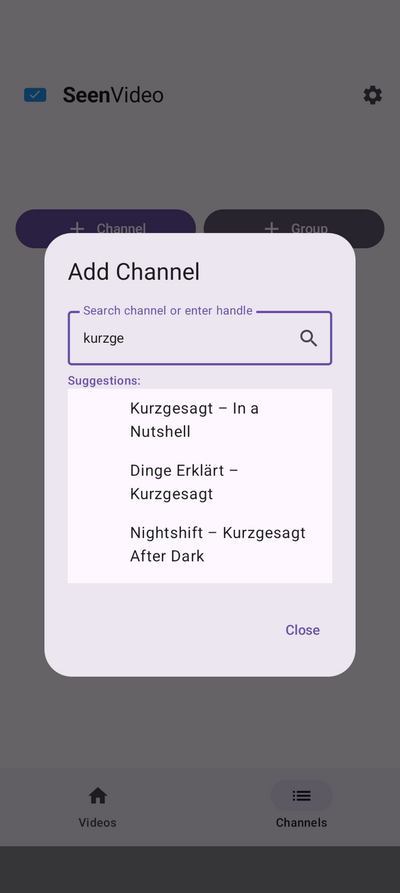
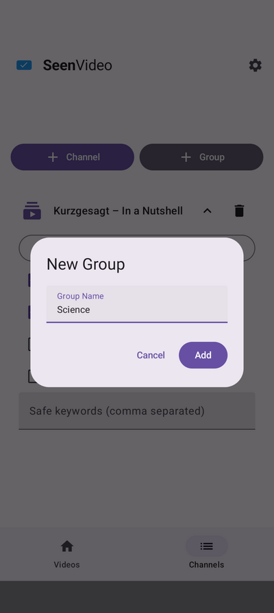
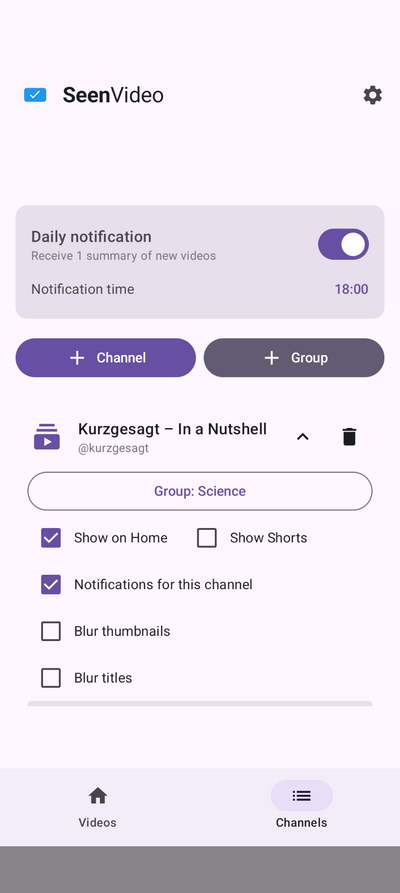
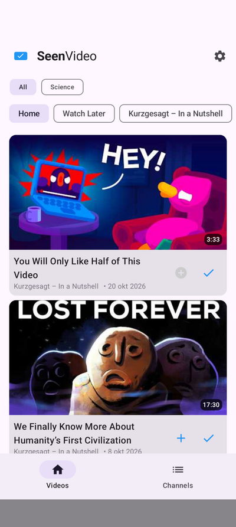
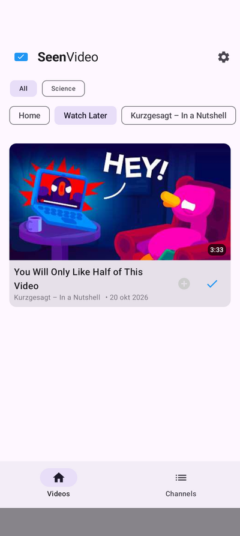
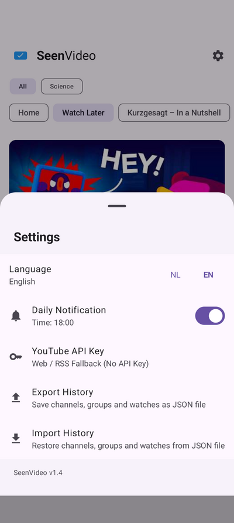

# SeenVideo

SeenVideo is a Free and Open Source (FOSS) Android application designed for a focused, local-first YouTube experience. It allows users to follow specific channels, organize them into custom groups, manage local "Watch Later" and "Watched" queues, filter out YouTube Shorts, and enjoy video feeds without distractions or account login requirements.

<p align="center">
  
</p>

## Previews

<p align="center">
  
  
  
</p>
<p align="center">
  
  
  
</p>

## Key Features

* **Local-First & No Account Required**: Completely private with no Google account login, tracking, or cloud sync required. All data remains 100% on your device.
* **Zero-Config Web & RSS Engine**: Works out-of-the-box using built-in YouTube RSS feed parsing and web scraping—no API key setup required!
* **Channel & Group Management**:
  * Follow channels by handle (e.g., `@VPROTegenlicht`) or using the built-in search.
  * Organize channels into custom groups (e.g., "News", "Documentaries", "Tech").
  * Filter your feed instantly using interactive group pills.
* **Shorts Filtering**: Option to automatically hide YouTube Shorts for a distraction-free long-form video feed.
* **Local Watch Later & Watched Tracking**:
  * Keep track of watched videos and maintain a local "Watch Later" queue.
* **Focus & Anti-Clickbait Tools**:
  * **Blur Titles & Thumbnails**: Blur video thumbnails and titles for specific channels to avoid clickbait or spoilers (tap to reveal).
  * **Safe Keywords**: Highlight or filter video titles containing specific keywords.
* **Centralized Settings (Gear Icon)**:
  * **Language**: Instant toggle between Dutch (Nederlands) and English.
  * **Daily Notifications**: Configure a daily summary notification schedule.
  * **Optional API Key**: Optional YouTube Data API v3 key setting if you prefer using your own key.
  * **Backup & Restore**: Easily export and import your channels, groups, and watch history as a JSON file.
* **Share Sheet Integration**: Share videos directly from the YouTube app into SeenVideo to queue them or mark them as watched.
* **Material 3 Design**: Modern, clean Jetpack Compose interface with full Dark Mode support.
* **Reproducible Builds**: Fully compliant with F-Droid reproducible build standards.

## Technical Stack

* **Language**: [Kotlin](https://kotlinlang.org/)
* **UI Framework**: [Jetpack Compose](https://developer.android.com/jetpack/compose) with Material 3
* **Architecture**: MVVM with Clean Architecture principles
* **Dependency Injection**: [Hilt](https://dagger.dev/hilt/)
* **Local Database**: [Room](https://developer.android.com/training/data-storage/room)
* **Networking**: [Retrofit](https://square.github.io/retrofit/), [OkHttp](https://square.github.io/okhttp/), & [Gson](https://github.com/google/gson)
* **Scraper Engine**: Built-in YouTube RSS Feed XML Parser & Web Scraper
* **Image Loading**: [Coil](https://coil-kt.github.io/coil/)

## Building from Source

SeenVideo builds 100% out-of-the-box with zero configuration files or external API keys needed:

1. Clone the repository:
   ```bash
   git clone https://github.com/your-username/SeenVideo.git
   cd SeenVideo
   ```
2. Build the release APK:
   ```bash
   ./gradlew assembleRelease
   ```
   The compiled APK will be at `app/build/outputs/apk/release/SeenVideo-1.4.apk`.

3. (Optional) Enter a custom YouTube Data API v3 key directly inside the app: **Settings (Gear Icon) -> YouTube API Key**.

## License

This project is licensed under the MIT License - see the [LICENSE](LICENSE) file for details.

## Privacy Policy & Terms

* [Privacy Policy](PRIVACY_POLICY.md)
* [Terms of Service](TERMS_OF_SERVICE.md)
